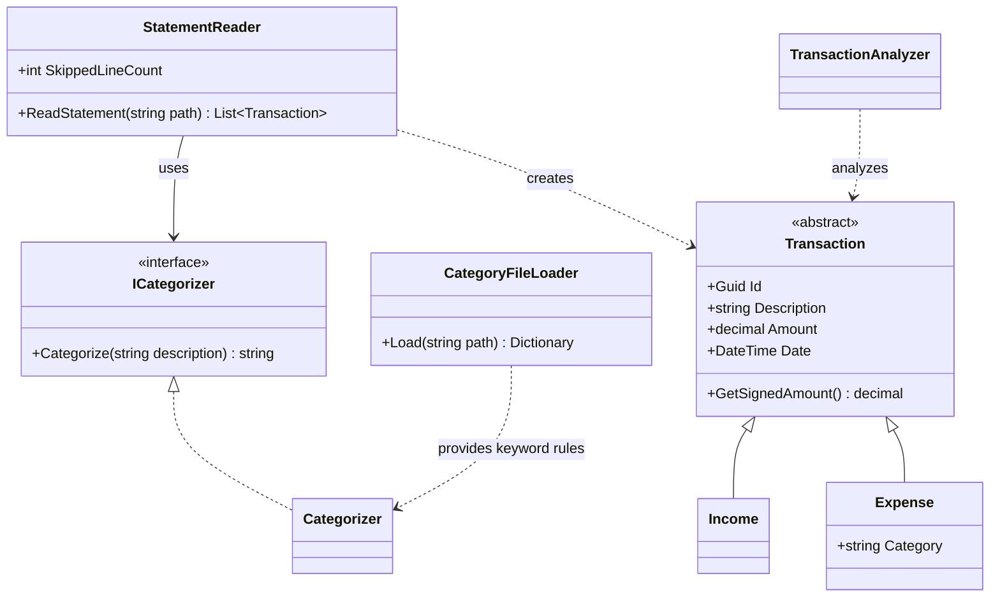

# LuminorSpendingTracker

A small C# console app that shows where my money goes.

Luminor does not offer a spending overview by category, so I built one myself. The app reads the statement file exported from Luminor, sorts every row into income or expense, guesses a category for each expense and prints a summary.

## What it does

- Reads a Luminor statement export (semicolon-separated text file).
- Turns each row into an `Income` or an `Expense`. Broken rows are skipped and counted.
- Cleans up card payment descriptions, for example `LIDL KAUNAS` instead of a long code.
- Gives each expense a category by looking for keywords (`LIDL` → `Food shopping`). The keywords live in `categories.json`, so they can be edited without touching the code.
- Prints expenses by category (largest first), the balance, the biggest expense and the biggest income.

## Example output

Based on the fake data in `PavyzdiniaiDuomenys.csv`:

```
2026-09-01 09:41     -4.10  CAFFEINE VILNIUS  [Coffee]
2026-09-03 10:15  +1250.00  Darbo užmokestis už rugpjūtį
...
Category Uncategorized: Total spent 300.00
Category Food shopping: Total spent 172.60
Category Shopping: Total spent 120.00
...
Total sum 655.12
Number of Transactions: 20
Biggest spend: 300.00 on Buto nuoma rugsėjui
Biggest income: 1250.00 from Darbo užmokestis už rugpjūtį
```

## How the classes fit together



